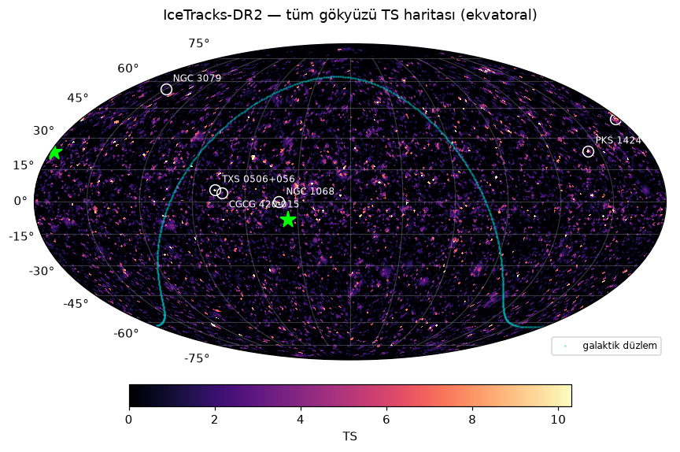
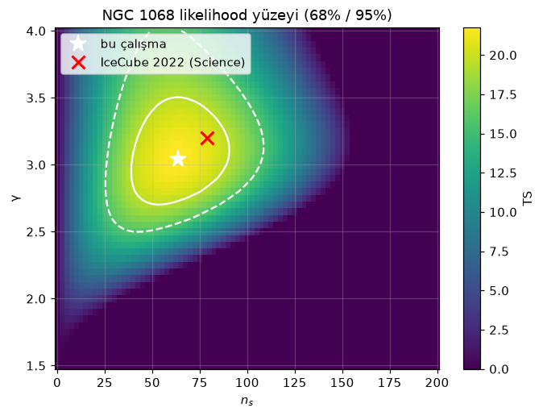

# vcube — Hunting neutrino sources with IceCube open data

The 2026 Nobel Prize in Physics went to Francis Halzen *"for decisive contributions to the IceCube Neutrino Observatory and the discovery of high-energy neutrinos of astrophysical origin"*.
This project re-derives IceCube's key point-source results **from scratch**, using only the public
[IceTracks-DR2](https://doi.org/10.7910/DVN/MMIIZA) release (14 years, 2008–2022, 1.64 M muon-track events) and a
self-written unbinned maximum-likelihood analysis.



## Results

**NGC 1068 is recovered at 4.3σ (local)** — matching IceCube's published 4.2σ evidence — with a soft spectrum very close to the published fit.

| Source | TS | $\hat n_s$ | $\hat\gamma$ | local p | local σ |
|---|---:|---:|---:|---:|---:|
| **NGC 1068** | 21.8 | 63 | 3.05 | 1.0 × 10⁻⁵ | **4.26** |
| NGC 4151 | 21.3 | 47 | 2.47 | 1.9 × 10⁻⁵ | 4.12 |
| PKS 1424+240 | 15.0 | 64 | 3.40 | 1.5 × 10⁻⁴ | 3.62 |
| CGCG 420-015 | 12.8 | 39 | 2.61 | 2.0 × 10⁻⁴ | 3.54 |
| GB6 J1542+6129 | 8.6 | 38 | 3.42 | 1.0 × 10⁻³ | 3.09 |
| NGC 3079 | 10.1 | 40 | 4.00 | 1.2 × 10⁻³ | 3.04 |
| TXS 0506+056 | 10.6 | 10 | 2.00 | 1.4 × 10⁻³ | 2.99 |

*p-values from 5000 RA-scrambled background trials per source (χ² tail fit beyond the last trial). Five more candidates (Mrk 421, Mrk 501, Crab, Cyg A, M87) show no significant excess.*

| | $\hat n_s$ | $\hat\gamma$ | Φ(1 TeV) [TeV⁻¹ cm⁻² s⁻¹] | significance |
|---|---:|---:|---:|---|
| IceCube 2022, *Science* (internal data, 2011–2020) | 79 | 3.2 | 5.0 × 10⁻¹¹ | 4.2σ (post-trial) |
| **This work** (public data, 2008–2022) | 63 | 3.05 | 2.4 × 10⁻¹¹ | 4.3σ local · 3.7σ after 12-source trials |

The published best fit lies inside this work's 68% contour (figure below); the flux normalisation is about half the published value.

Other findings:
- **All-sky scan** (nside 64): hottest spots TS = 20.7 (north, RA 177.9°, δ +23.3°) and TS = 14.7 (south, RA 35.9°, δ −8.4°). Their post-trial significance needs more scrambled-sky scans than have been run so far (work in progress).
- **Seyfert stacking** (NGC 1068, NGC 4151, NGC 3079, CGCG 420-015): TS = 55. This is *not* a discovery claim — the catalogue was picked knowing these sources are already warm, and the p-value is a χ² extrapolation from 300 trials. It is included to demonstrate the stacking machinery.
- **ICECAT-1:** 293 of the 348 real-time alerts are also events in the DR2 track sample (same event IDs); alert **IC170922A** lies 0.12° from TXS 0506+056, the 2017 blazar coincidence.
- **A lesson learned:** the event selection raises the energy threshold steadily south of the horizon (~0.1 in log₁₀E per degree). Coarse background bins in sin δ produced a fake TS ≈ 45 "source" near the south pole and inflated background TS around the equator; declination-uniform, 2°-wide southern bins fixed both (see `tests/test_llh.py`).



## What's inside

| Notebook | Content |
|---|---|
| [01_veri_kesfi](notebooks/01_veri_kesfi.ipynb) | The data: seasons, sky/energy distributions, angular errors, effective area |
| [02_ngc1068](notebooks/02_ngc1068.ipynb) | Single-source likelihood fit for NGC 1068 and 11 other candidates, background trials, likelihood contours, sensitivity |
| [03_tum_gok](notebooks/03_tum_gok.ipynb) | All-sky scan (HEALPix nside 64), hottest spots, look-elsewhere correction |
| [04_stacking_alerts](notebooks/04_stacking_alerts.ipynb) | Seyfert-galaxy stacking; cross-match with the ICECAT-1 real-time alert catalogue (IC170922A ↔ TXS 0506+056) |

Notebook text is in Turkish; code and this README are in English.

### Method

For a source at $(\alpha_s, \delta_s)$ the likelihood over all events $i$ in season $s$ is

$$\log\mathcal{L}(n_s,\gamma) = \sum_s \sum_{i\in s} \log\Big[\tfrac{n_{s}f_s(\gamma)}{N_s}\,\tfrac{S_i(\gamma)}{B_i} + 1 - \tfrac{n_{s}f_s(\gamma)}{N_s}\Big]$$

- **Signal** $S_i$: von Mises–Fisher spatial PDF with the per-event angular error × reconstructed-energy PDF of an $E^{-\gamma}$ flux, built from the release's smearing matrix weighted by the effective area.
- **Background** $B_i$: data-driven, uniform in right ascension, binned in $\sin\delta$ and $\log E$.
- $f_s(\gamma)$: share of signal expected in each season (effective area × livetime).
- Significance from RA-scrambled pseudo-experiments; signal injection samples the smearing matrix.

Code lives in [`src/vcube`](src/vcube): `data` (loading) · `irf` (effective areas, smearing) · `pdfs` · `likelihood` · `trials` · `sources` (catalogue, stacking) · `skymap` · `alerts` (ICECAT-1).

## Running it

```bash
python -m venv .venv
.venv/Scripts/python -m pip install -e ".[dev]"      # Linux/macOS: .venv/bin/python
.venv/Scripts/python scripts/download_data.py          # ~1 GB from Harvard Dataverse
.venv/Scripts/python -m pytest
.venv/Scripts/python scripts/run_source_trials.py      # background trials per candidate
.venv/Scripts/python scripts/run_skymap.py --nside 64  # all-sky scan
.venv/Scripts/python scripts/run_skymap.py --nside 32 --scrambles 20   # hottest-spot calibration
.venv/Scripts/python -m nbconvert --to notebook --execute --inplace notebooks/*.ipynb
```

## Caveats

- Only the IC86 smearing matrix is downloaded by default; IC40/IC59/IC79 (~3 of 14 years) reuse it. `download_data.py --all` fetches the others (+2.6 GB).
- The public release lacks IceCube's azimuth-dependent responses and the improved internal reconstructions, so results are expected to differ somewhat from published ones.
- This is an independent reanalysis for learning and demonstration, not an IceCube Collaboration result.

## Data & references

- IceCube Collaboration, *IceTracks-DR2* — [doi:10.7910/DVN/MMIIZA](https://doi.org/10.7910/DVN/MMIIZA), [arXiv:2605.19040](https://arxiv.org/abs/2605.19040)
- IceCube Collaboration, *ICECAT-1* — [doi:10.7910/DVN/SCRUCD](https://doi.org/10.7910/DVN/SCRUCD), [arXiv:2304.01174](https://arxiv.org/abs/2304.01174)
- IceCube Collaboration, *Evidence for neutrino emission from NGC 1068*, Science 378, 538 (2022)
- Braun et al., *Methods for point source analysis in high energy neutrino telescopes*, Astropart. Phys. 29, 299 (2008)
- SkyLLH public-data reference implementation — [arXiv:2308.12733](https://arxiv.org/abs/2308.12733)
